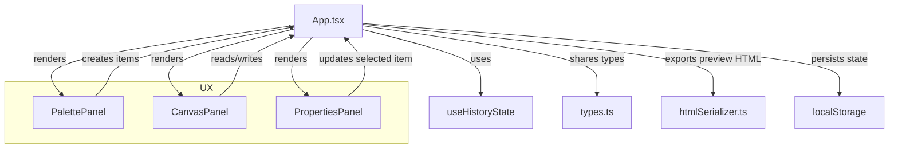

# Architecture Overview

Aura is a modular no-code editor built around a central editor state and three main UI panels.

## Core layers

1. Editor state layer
   - Managed in `src/App.tsx` using React state and the `useHistoryState` hook.
   - Includes canvas items, selected item ID, preview mode, and drag state.
2. UI layer
   - `PalettePanel` for inserting components.
   - `CanvasPanel` for rendering draggable items and selection.
   - `PropertiesPanel` for editing selected item styles and preview controls.
3. Utility layer
   - `src/lib/htmlSerializer.ts` converts the canvas model into exported HTML.

## Component flow

- `App.tsx` initializes the editor state and passes props down to each panel.
- `PalettePanel` emits drag start events to create a ghost preview and add new items when dropped on the canvas.
- `CanvasPanel` renders items and handles item selection, movement, and inline text editing.
- `PropertiesPanel` exposes property controls that update the selected item in real time.
- Preview and HTML export update from the same shared canvas model.

## Data flow diagram

## Responsive design

- Bootstrap `Row` and `Col` provide responsive column layout.
- The canvas panel expands on large screens and stacks vertically on smaller widths.
- `src/App.css` includes breakpoints for panel padding and layout spacing.

## Reusable architecture patterns

- Custom hook: `useHistoryState` implements undo/redo with past/present/future state.
- Shared types: `AuraCanvasItem`, `EditorState`, and `PreviewMode` provide predictable structures.
- Component isolation: visual components receive props and callbacks, with no direct state mutation.
